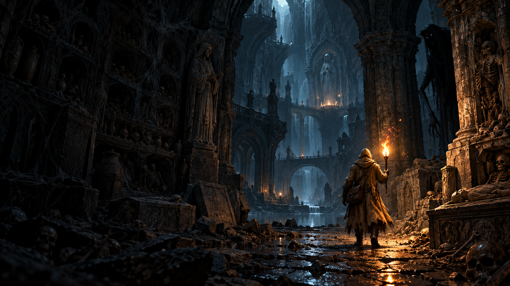

# The Last Light

**When the flame dies, the hunt begins.** A browser survival horror expedition built with TypeScript, Three.js and Vite. Explore ancient catacombs, manage a fragile torch, collect relics and escape to sanctuary. Extinction starts a survivable Hunt rather than an arbitrary death countdown.

This repository documents the development process as well as the game: prompts, generated asset provenance, rejected experiments, animation tools, deterministic tests and actual browser checks. The shipped game runs on static hosting without inference services, API keys or a backend.



## Play and build locally

Node.js 22+ recommended. Install dependencies, then choose a command:

```sh
npm ci
npm run dev
```

```sh
npm test
npm run build
npm run preview
```

Open the URL printed by Vite. WebGL2 is required. Audio starts after a click or tap. `npm run build` creates `dist/`; the included [render.yaml](render.yaml) configures a Render static site with `npm ci && npm run build` and publish directory `dist`. Python, Blender, Hugging Face and ComfyUI are asset-authoring tools, not requirements to play or build the shipped game. Optional Google Fonts have system fallbacks.

## Controls and survival

| Device                | Controls                                                                                                                                                                       |
| --------------------- | ------------------------------------------------------------------------------------------------------------------------------------------------------------------------------ |
| Keyboard/mouse        | WASD move; drag either mouse button or arrows to look; wheel zoom; Shift sprint; C/Ctrl crouch; E interact/relight; Q chalk; F burst; 1/2/3 flame mode; Tab journal; Esc pause |
| Xbox standard mapping | LS move; RS look; RT/LS click sprint; B toggle crouch or hold LT; A use; X burst; Y chalk; LB/RB flame mode; D-pad up/down zoom; RS click recenter; View journal; Menu pause   |
| Touch                 | Left joystick move; drag open view to look; hold RUN; toggle CROUCH; USE/BURST/CHALK/JOURNAL buttons; flame and zoom buttons                                                   |

Optional Capture Mouse enables free look when supported; dragging remains available when pointer lock is rejected. Controller menus support stick/D-pad navigation, A select, B back, and left/right adjustment. Touch supports simultaneous movement, looking and sprinting, safe-area padding, portrait/landscape layouts and a scrollable menu. Preview touch layout with `?touch`. Settings include sensitivity, sound, visual audio cues and graphics quality.

For an iPhone, use the deployed HTTPS site. PC localhost is not reachable from the phone. For same-Wi-Fi development, explicitly run `npm run dev:lan` and use the PC LAN address on port 5173; controller APIs may require HTTPS. Physical Xbox/iPhone validation remains pending; automated input tests are not a substitute.

- Ember conserves fuel, Steady supports exploration, and Blaze spends fuel quickly for stronger light. Deeper rooms increase fuel pressure.
- A full basic torch holds 720 Steady fuel-seconds before depth modifiers. Extinction gives an eight-second grace period, followed by an active searching Hunter.
- Relighting consumes a match, takes two seconds before upgrades, restores reserve fuel, slows movement and prevents sprinting. Find cover first.
- Crouching quiets footsteps and reduces Hunter visual range; close detection and remembered positions still matter. Corners break line of sight.
- Sprint stamina recovers after a brief rest. Flame Burst costs fuel and cannot repel creatures through masonry.
- Relit torchlight makes the Hunter flee along navigable paths before banishment. Sanctuary fire provides safety. Stalkers threaten a weak flame; brighten it or retreat.
- Bank carried relics at the destination sanctuary. Death loses carried relics; browser-local permanent upgrades survive. Saves belong to the browser and origin.

At sanctuary, buy Reservoir (+90 fuel-seconds, one relic, five ranks), Efficient Wick (8% less burn/rank), Soft Boots (12% quieter footsteps/rank), Quick Spark (0.25 seconds faster relighting/rank), or Sanctuary Compass. The latter costs three relics and provides a bearing, not a route through walls; the other three upgrades cost two relics/rank, up to three ranks.

## How we are building it

The project began with a full game specification, then prioritized an integrated Catacombs slice: controller/camera, torch, Hunt, expedition, persistence, generated art, audio and balancing. Each pass changes a small coherent system, adds meaningful regressions, builds the production bundle and exercises gameplay. [BUILD_STATUS.md](BUILD_STATUS.md) records outcomes and remaining work.

Our practical loop is **specify → implement → generate/review assets → integrate → test → play → revise**. Compilation alone is not acceptance. For example, an initially harsher stamina recovery change caused the existing no-match escape scenario to fail; it was retuned before keeping it. We also rejected fragmented floor reconstructions, kept their provenance, and used an explicitly documented derivative of an accepted neural wall mesh instead.

[Build prompts and contributor workflow](docs/BUILD_WORKFLOW.md) contains a reusable condensed development brief and the review checklist. This is a reusable summary of the original specification, not a claim to preserve every conversational prompt verbatim.

### Architecture

| Module                                                                  | Responsibility                                                                                                  |
| ----------------------------------------------------------------------- | --------------------------------------------------------------------------------------------------------------- |
| `src/simulation.ts`                                                     | Seeded rooms, shared collision/navigation, torch/Hunt/perception, stamina, expedition, upgrades and persistence |
| `src/main.ts`                                                           | 60 Hz fixed-step accumulator, input integration, HUD, menus and progression screens                             |
| `src/scene.ts`, `src/character.ts`                                      | Three.js rendering, camera collision, particles, skeletal animation and torch socket                            |
| `src/catalog-assets.ts`                                                 | Shared generated GLB loading, cloning, instancing and disposal                                                  |
| `src/crypt-layout.ts`, `src/dungeon-dressing.ts`, `src/crypt-decals.ts` | Burial furniture, shared blockers, seeded dressing and wear decals                                              |
| `src/controls.ts`, `src/platform-input.ts`                              | Camera controls, gamepad mapping, touch pointers and menu input                                                 |
| `src/audio.ts`, `src/soundscape.ts`                                     | Generated/synthesized audio, positional cues and state-based mixing                                             |
| `src/qa.ts`, `src/*.test.ts`                                            | Navigated expedition driver and deterministic regression tests                                                  |

Grid cells represent two metres. Simulation light/perception does not depend on graphical quality. Rendering does not own character collision or AI decisions. Procedural room placement assembles assets; it does not replace generated art with procedural prop meshes.

## Art prompts and the image-to-GLB pipeline

The palette and silhouettes come from the [art bible](docs/art-direction/ART_BIBLE.md) and [concept board](docs/art-direction/concept-board.png): ochre cloak and satchel, elongated ragged Hunter, cold masonry, warm flame, oppressive burial architecture.

The runtime catalog currently contains **39 GLB roles from 38 accepted neural reconstructions**, including generated characters, architecture, props, skeletal remains, webs and burial details. Hollow/Moth are expansion previews, not implemented enemy behaviors. See [catalog pipeline and provenance](docs/CATALOG_ASSETS.md), [dungeon dressing](docs/DUNGEON_ATMOSPHERE.md), and [dense crypts and decals](docs/CRYPT_DENSITY.md).

1. **Catalog and reference.** Define a stable asset ID, prompt, dimensions, triangle budget and reference image. Reference batches used the existing local ComfyUI SDXL/Juggernaut workflow. Inspect silhouette, material and reconstruction suitability before continuing.
2. **Neural reconstruction.** Use the shared asset library's serial queue. Accepted sources used TRELLIS.2-4B through the Hugging Face demo, with the brazier using the installed local ComfyUI TRELLIS workflow. This was not full local TRELLIS inference on the 8 GB development GPU.
3. **Finish.** Preserve the original source; use Blender for scale, ground pivot, budget reduction and LOD inspection. Reject unusable results rather than disguising them as finished art.
4. **Import.** Pack embedded textures, record hashes/reference/model/seed/provider provenance, and install the GLB plus its catalog manifest. Most textures use 512px; detailed dressing uses up to 1024px. Actual settings are recorded per asset.
5. **Integrate and inspect.** View `/asset-review.html`, then review scale, visibility, collision, dressing density and performance in real gameplay. Generated drafts are not automatically approved production art.

The original shared library is **outside this repository**, at `C:/Users/coryc/Documents/Codex/2026-10-17/cre/outputs/last-light-asset-library`. Its `scripts/assetlib.py`, full catalog, raw jobs and authoring environments are not supplied by a clone of this repo. Runtime GLBs and per-import provenance are included in `public/models/catalog/` and `docs/catalog-assets/`. Repository finishing scripts currently contain development-machine Blender paths; adapt them to your installation.

With that external library and its dependencies available, first read its instructions, run `status` and `doctor`, and resolve uncertain jobs. Use one serial worker on the shared GPU. From the game repository, completed candidates can be finished/imported with:

```sh
python tools/assets/finish_catalog.py LIBRARY_ROOT ASSET_ID
python tools/assets/import_catalog.py LIBRARY_ROOT ASSET_ID
```

Do not run import commands against unfinished or rejected jobs. [The catalog guide](docs/CATALOG_ASSETS.md) explains binding, promotion and the paving derivative. Model weights and authoring caches remain ignored in `.asset-tools/`.

### Where the exact prompts live

| Material                  | Reproducible record                                                                                                                                               |
| ------------------------- | ----------------------------------------------------------------------------------------------------------------------------------------------------------------- |
| Imported 3D assets        | Per-asset `definition.json`, `generation.json` and `preparation.json` under [docs/catalog-assets](docs/catalog-assets/), plus runtime manifests                   |
| Soundtrack and effects    | [audio-prompts.json](tools/assets/audio-prompts.json): exact prompts, durations and seeds; [audio manifest](public/audio/manifest.json): actual output provenance |
| Planned motion generation | [motions.json](tools/assets/motions.json); these prompts are not evidence that generated motions shipped                                                          |
| Title-screen background   | [full imagegen prompt](docs/TITLE_BACKGROUND.md) and [PNG](public/art/title-background-v1.png); no lettering or menu was baked into the art                       |
| Crypt wear decal atlas    | [full prompt and integration notes](docs/CRYPT_DENSITY.md)                                                                                                        |

Prompting lesson: specify the intended use, silhouette, material, pose, scale and exclusions, then inspect the result in context. A pleasing reference image does not guarantee usable 3D geometry or deformation.

### Rigging and animation: actual status

Current Torchbearer/Hunter/Stalker meshes are neural outputs, automatically bound to existing skeleton donors with authored baked motion. The player pass corrected lower-leg weights and fitted locomotion/torch carry; the Hunter pass added navigated fleeing and new state clips. [Player animation notes](docs/CHARACTER_ANIMATION.md) and [Hunter notes](docs/HUNTER_BALANCE.md) explain the implementation and limitations.

`build_characters.py` creates legacy donors; `bind_generated_character.py`, `player_motion.py`, `hunter_motion.py` and `promote_character.py` bind, bake and promote generated characters. This is **not** a successful NVIDIA-generated animation pipeline. Kimodo export stalled; no verified output was integrated. Mesh2Motion replacement was requested and prepared but remains pending browser file-upload access: [handoff](docs/MESH2MOTION_STATUS.md). [Earlier model research](docs/AI_ASSET_PIPELINE.md) is historical, not the current shipped mesh source.

## Soundtrack and effects pipeline

Nine generated clips ship alongside synthesized gameplay audio. Music used ACE-Step-v1-3.5B and effects used MOSS-SoundEffect-v2.0 through their official Hugging Face demos. These were hosted generations, not local audio-model inference. Model/provider links, limitations and license records are in [AUDIO.md](docs/AUDIO.md).

The exploration prompt begins: “Instrumental dark ambient survival horror soundtrack in D minor, very sparse bowed low strings, distant resonant stone chamber…” Constraints exclude vocals, drums, jump scares and ambient footsteps, preserving real enemy footsteps as useful signals. The Hunt bed stays restrained so positional threats remain audible; sanctuary offers fragile relief. Exact full prompts and seeds are in the linked JSON.

`generate_audio.py` records provider responses and raw sources in ignored `.asset-tools/audio/raw`; `master_audio.py` removes DC/rumble, conditions loop boundaries, bounds peaks and encodes MP3 using FFmpeg. These authoring scripts need Python dependencies, HF authentication and provider availability. A fresh clone cannot remaster without raw sources. Runtime crossfades by game state, caps one-shots and retains synthesized fallbacks. Listen at `/audio/listen.html`.

Licensing notes record the models used at generation time; inspect the per-asset records and applicable terms before redistribution. No AI model weights are bundled.

## Verification and learning checkpoints

- `npm test`: currently 61 tests covering collision, camera, fuel, extinction, navigation, sight/sound, sanctuary, saves, upgrades, inputs, catalog integrity and balance.
- Python asset checks: `python -m unittest discover -s tools/assets -p "test_*.py"` (requires authoring dependencies).
- `/?debug&seed=104729`: reproducible world and developer menu. H forces Hunt, R refills, T teleports to destination. **RUN EXPEDITION CHECK** physically follows navigation through extinction, active Hunt, escape and banking; it is not a human pacing test.
- **CHECK HUNTER RETREAT** exercises relighting and fleeing. `/?debug&seed=104729&dressing` opens a repeatable dressing review position.
- Latest balance browser run completed the no-match escape in 1:00, with no warning/error logs observed. This accelerated route does not establish the intended 10–20 minute human expedition length.
- [v1 video](docs/demos/README.md), [title screen](docs/title-screen-v1.png), [latest escape](docs/balance-escape-v2.png), and [build log](BUILD_STATUS.md) show checkpoints, not promises of final quality.

This is a playable Catacombs checkpoint. Intended session pacing, physical device testing, sustained performance, final art/deformation acceptance, Mesh2Motion replacement, additional biomes and expansion enemy behavior remain work in progress. The production build still reports a large Three.js chunk warning. Keep experimental failures and pending work visible so others can learn what actually worked.
