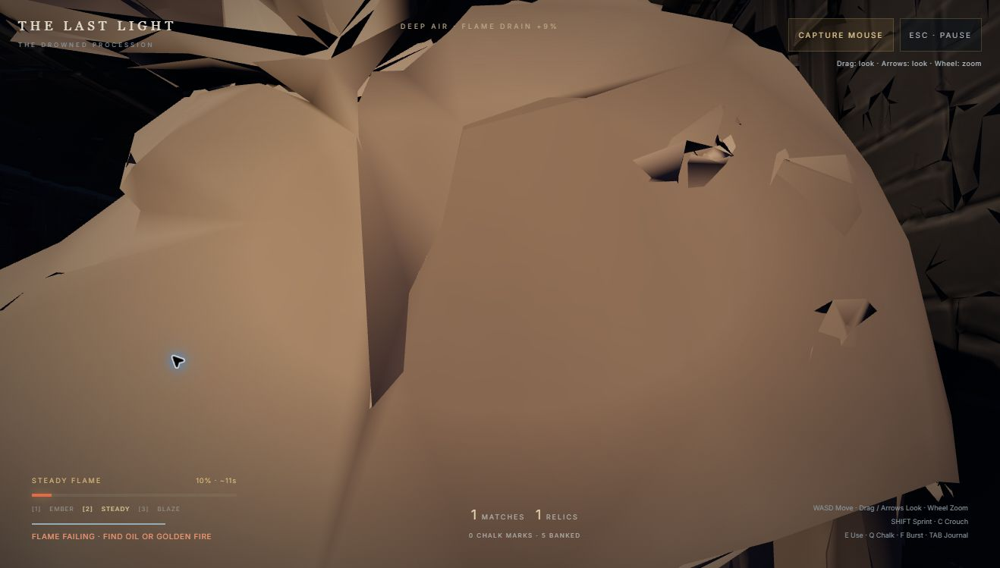
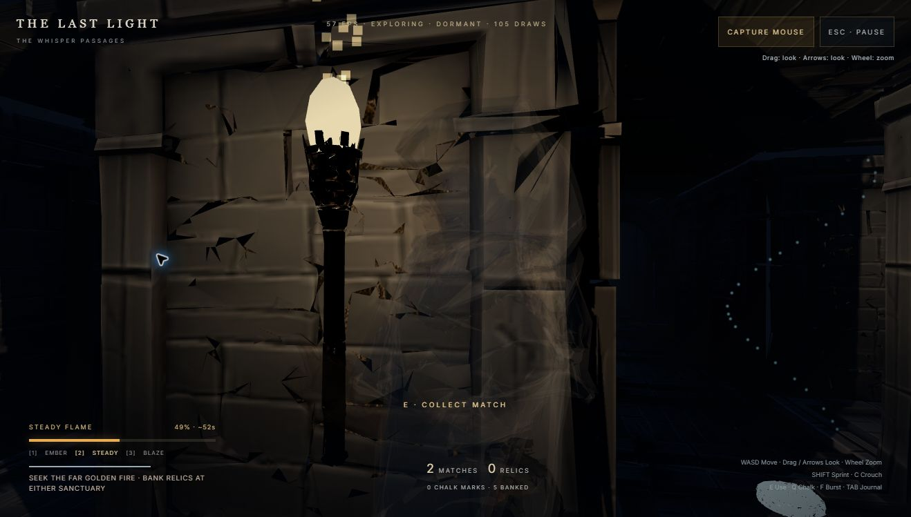

# Development response to the critic

The source feedback is preserved separately in [the critic playtest](CRITIC_PLAYTEST_2026-10-20.md). Gameplay, camera/graphics and audio agents received those findings, implemented separate changes, and handed them back for integration.

| Critic finding | Implemented response | Evidence |
| --- | --- | --- |
| First W points into a wall. | Exit-side spawn and shared camera heading derive from the first graph connection; near-fire load relocation follows the same axis. | Five-seed straight-forward movement regression; ordinary browser walk through the entrance without steering. |
| Early fuel is spent searching without a goal. | Move one existing ordinary relic to the first-room procession approach. Local find/claim/return guidance; no extra currency, global markers or fuel. | Forty-seed reachability/placement checks and ordinary browser claim/return/bank loop (0:47 simulation time). |
| Hood/sidewall fills narrow-arch view. | Collision-aware shoulder recentering, forward framing, owned avatar-material fade below 1.7m camera clearance. Architecture stays opaque. | Tests use actual generated passage blocker dimensions and verify material/depth restoration. Browser after-check is a separate diagnostic, not part of the critic's ordinary play. |
| Nearest turn unreadable in darkness. | Smoothly appearing cold camera fill with 3.2m range and no shadow map; distant fog and AI visibility unchanged. | Render integration and browser check; subjective human visibility still needs broader play. |
| Death does not explain capture or loss. | Exact Hunter/Stalker capture cause, relevant counterplay, truthful unbanked-loss wording. | Capture/reset regressions; UI inserts text safely. |
| Blaze consumes the newly lit reserve immediately. | Successful emergency relight switches only Blaze to Steady, explains it, preserves Ember, grants no extra fuel. | Tests all three modes and fuel bounds; save/load still preserves voluntarily chosen Blaze outside recovery. |
| Audio transient might be lost at death. | Code review confirmed immediate master mute suppressed the ending. Short quiet cause-specific defeat cues now fade with AudioParam automation; retries cancel that envelope. | Two ending/fade regressions; no timer that can silence a new run. Actual headphone mix was not heard by the critic or certified by developers. |

## Verification and remaining work

- `npm test`: 114 pass, 0 fail.
- `npx tsx tools/check-expeditions.ts 100`: 100 pass. This is the diagnostic route harness, separate from ordinary critic play.
- `npm run build`: pass; existing Three.js bundle size warning remains.
- Integration ordinary browser play: walk through first arch, claim The Child's Vigil, reverse through the corridor, interact at the starting fire; one relic banked and sanctuary result shown. This validates a short risk/return loop, not a ten-minute expedition.

The critic still recommends richer visual landmarks, softer flame forms and additional human headphone testing. Those lower-priority aesthetics are not represented as complete. Full Xbox/iPhone validation, long-Hunt two-Hunter human evasion and broad sustained performance remain open.

## Camera evidence

The critic's original occlusion (ordinary live play):

After implementation, a separate narrow-passage diagnostic compressed the camera enough to reduce player opacity to approximately 0.10 while leaving stone opaque and the opening readable. That observation showed roughly 54–56 FPS and no console warnings/errors. It is a targeted regression check at a different location, not a matched screenshot comparison or full performance benchmark.

