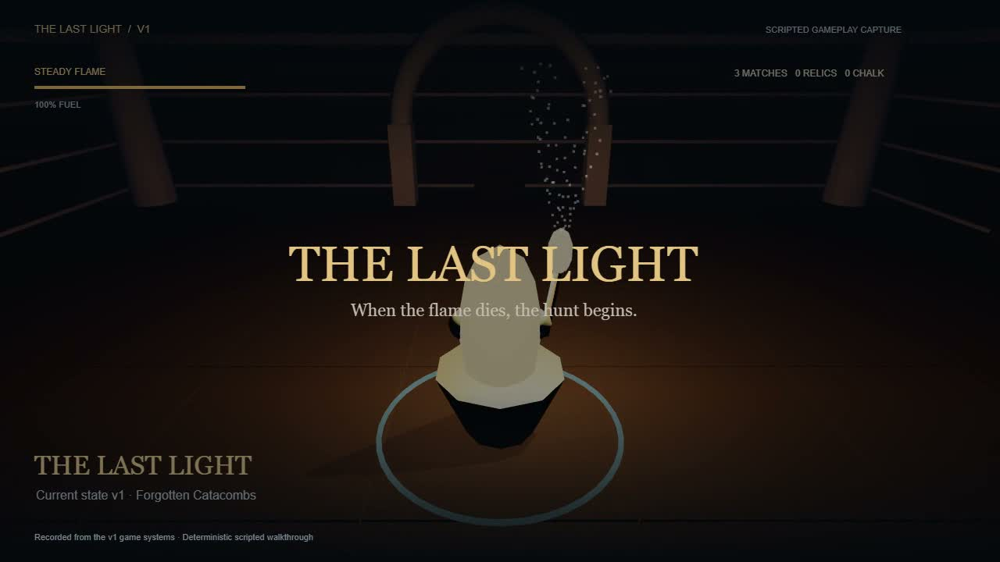

# The Last Light — current state v1 demo

[Watch / download the MP4](the-last-light-v1.mp4)

[](the-last-light-v1.mp4)

Recorded October 17, 2026 from the playable Catacombs checkpoint based on commit `8bf08d7`.

- Duration: **70.875 seconds** (1,701 frames).
- Picture: 1280 × 720, 24 fps, H.264 / yuv420p.
- Sound: the game's synthesized audio, stereo AAC at 48 kHz, normalized for the demo.
- File size: approximately 11 MB.

## What it shows

| Time | Current functionality                                   |
| ---- | ------------------------------------------------------- |
| 0:00 | Title and starting sanctuary                            |
| 0:04 | Third-person exploration, artifact collection and chalk |
| 0:11 | Ember fuel-conservation mode                            |
| 0:17 | Blaze illumination mode                                 |
| 0:38 | Deliberately triggered extinction                       |
| 0:39 | Eight-second Hunt grace period                          |
| 0:47 | Hunter activation and a camera look toward the creature |
| 0:49 | Two-second match relight                                |
| 0:51 | Hunter banishment and continued exploration             |
| 1:07 | Sanctuary recovery and banking one relic                |

This is a **scripted, deterministic gameplay capture**, using the actual game simulation, Three.js renderer, and original procedural game audio. Movement follows the navigation route; the extinction trigger and camera are scripted to demonstrate the systems. Presentation captions and a compact HUD are composited over the rendered frames. There is no fabricated gameplay footage or borrowed cinematic material.

Frames are rendered offline at fixed steps, so this recording **does not demonstrate real-time frame rate**. It documents the current v1 checkpoint; the full master specification, 10–20 minute pacing, art polish and performance acceptance remain in progress. The capture page does not load the player's normal saved game.

## Reproduce

1. Run `npm ci`, then `npm run demo:record`.
2. Open `http://127.0.0.1:5180/demo.html`.
3. Click **Record v1 walkthrough** and wait for COMPLETE.
4. Download the IVF video, WAV audio, and JSON timeline.
5. With FFmpeg installed, combine the two captures:

```sh
ffmpeg -i the-last-light-v1.ivf -i the-last-light-v1.wav -c:v libx264 -preset medium -crf 20 -pix_fmt yuv420p -c:a aac -ar 48000 -b:a 160k -af "loudnorm=I=-20:TP=-2:LRA=12" -shortest -movflags +faststart the-last-light-v1.mp4
```

The recorder requires Chromium/WebCodecs VP8 encoding support. `src/demo-record.ts` contains the shot sequence and original IVF/WAV packaging. `GameAudio.start()` accepts an optional offline audio context for capture; normal gameplay still uses a real-time audio context.

## Verification

- The capture asserts sanctuary completion, successful relighting and at least one banked relic before offering downloads.
- FFmpeg decoded the final MP4 without errors; FFprobe confirmed the dimensions, frame rate, stereo audio and duration.
- Sample frames were visually reviewed; see [contact sheet](the-last-light-v1-contact-sheet.jpg).
- Audio is present with no digital clipping (measured peak about −1.8 dBFS).
- Game tests: 22 passed. Production build passes.
